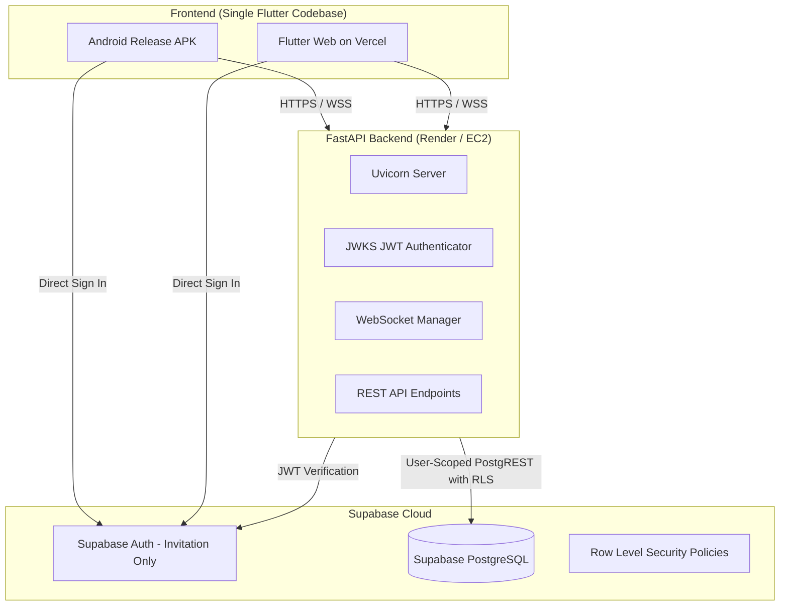

# Private Chat App

A production-minded, lightweight, invitation-only private messaging application for a small group of 7–8 approved members. 

Engineered with strict security, high reliability, zero-cost (₹0/month) development, and an original, polished Material 3 messaging interface inspired by modern chat applications.

---

## 1. Architecture Overview



---

## 2. Technology Stack

| Layer | Technology | Details |
|---|---|---|
| **Frontend** | Flutter & Dart | Single codebase for Android & Web, Material 3, Riverpod state management. |
| **Backend** | Python 3.12+ / FastAPI | Uvicorn, Pydantic v2, WebSockets, JWKS token verification. |
| **Database & Auth** | Supabase Auth & PostgreSQL | Invitation-only access, Row Level Security (RLS) on all tables, stored procedures. |
| **DevOps & CI** | GitHub Actions | Cloud-based APK builds (no local Android SDK required), backend lint & unit tests. |
| **Hosting** | Render & Vercel | Render for FastAPI backend (EC2 ready), Vercel for Flutter Web. ₹0/month free tier. |

---

## 3. Cost Requirement & Free-Tier Limits (₹0/Month)

The entire infrastructure runs on free tiers:
- **Render (Backend)**: Free Web Service. Free instances spin down after 15 minutes of inactivity. When a request arrives, spin-up (cold start) takes ~45–50 seconds. WebSockets terminate on spin-down; the Flutter client features automatic exponential backoff reconnection.
- **Vercel (Flutter Web)**: Free hobby tier. Fast global CDN edge deployment.
- **Supabase (Auth & Postgres)**: Free tier includes up to 50,000 monthly active users and 500MB database storage (more than sufficient for 7–8 members).
- **GitHub Actions**: 2,000 free runner minutes per month for automated APK builds and backend CI.

---

## 4. Key Security & Privacy Guarantees

1. **Invitation-Only Access**:
   - Public registrations are explicitly disabled in Supabase Auth settings.
   - New accounts are provisioned by the designated group administrator.
   - Non-approved or revoked users are blocked by database RLS and FastAPI dependencies with `403 Forbidden`.
2. **Row Level Security (RLS)**:
   - Users can read only conversations they belong to.
   - Users can read and insert messages only in conversations where they are verified members.
   - Anti-spoofing constraints ensure `sender_id` must match `auth.uid()`.
   - Normal users cannot modify `is_approved` or elevate themselves to `is_admin`.
3. **Privileged Keys Isolated**:
   - The Supabase `service_role` key is strictly kept server-side in FastAPI environment variables.
   - Neither the Flutter client nor browser code ever receives privileged credentials.
4. **JWKS Token Verification**:
   - FastAPI dynamically verifies JWT tokens against Supabase's JWKS endpoint (`.well-known/jwks.json`) with in-memory caching.
5. **Strict 1-to-1 Conversation Invariant**:
   - Conversations are guaranteed to have exactly two distinct approved members.
   - Canonical ordering prevents duplicate conversations between the same two users.

---

## 5. Repository Structure

```
ChatApp/
├── .github/
│   └── workflows/
│       ├── android-apk.yml          # Cloud-based Android APK build workflow
│       └── backend-ci.yml           # Backend lint, tests, and migration checks
├── apps/
│   └── chat_app/                    # Flutter codebase (Android & Web)
│       ├── android/                 # Android build & manifest configs
│       ├── web/                     # Web entrypoint and manifest
│       ├── lib/
│       │   ├── core/                # Config, themes, network, auth
│       │   ├── features/            # Auth, conversations, chat screens
│       │   └── shared/              # Reusable widgets and data models
│       ├── pubspec.yaml             # Flutter dependency manifest
│       └── vercel.json              # Vercel SPA routing configuration
├── backend/                         # FastAPI backend
│   ├── app/
│   │   ├── api/                     # REST routes, dependencies, WebSockets
│   │   ├── core/                    # Config, security (JWKS), database clients
│   │   ├── schemas/                 # Pydantic v2 data transfer objects
│   │   ├── services/                # Auth, chat, and realtime connection services
│   │   └── main.py                  # App initialization, CORS, lifespan
│   ├── tests/                       # Pytest automated test suite
│   ├── Dockerfile                   # Containerized deployment for EC2
│   ├── render.yaml                  # Render deployment blueprint
│   └── requirements.txt             # Pinned backend dependencies
├── supabase/
│   ├── migrations/                  # Versioned SQL migrations with RLS
│   └── README.md                    # Supabase setup and administrator guide
├── .env.example                     # Environment template
├── DEPLOYMENT.md                    # Render, Vercel & APK deployment guide
└── MIGRATION_EC2.md                 # Future migration guide from Render to AWS EC2
```

---

## 6. Local Development Setup

### 6.1 Backend (FastAPI)
1. Navigate to `backend/`:
   ```bash
   cd backend
   python3 -m venv .venv
   source .venv/bin/activate
   pip install -r requirements.txt
   ```
2. Copy the environment template:
   ```bash
   cp .env.example .env
   ```
   Fill in your Supabase project URL and keys.
3. Run the test suite:
   ```bash
   pytest -v
   ```
4. Start the local development server:
   ```bash
   uvicorn app.main:app --reload --port 8000
   ```
   Interactive API docs are available at `http://localhost:8000/docs`.

### 6.2 Frontend (Flutter Web)
1. Navigate to `apps/chat_app/`:
   ```bash
   cd apps/chat_app
   ```
2. Run on Chrome:
   ```bash
   flutter run -d chrome --dart-define=API_BASE_URL=http://localhost:8000 --dart-define=WS_BASE_URL=ws://localhost:8000/ws
   ```

---

## 7. Cloud Android APK Build

To download an Android APK without installing Android Studio locally:
1. Push your changes to GitHub or trigger the workflow manually under **Actions -> Android APK Cloud Build -> Run workflow**.
2. Once the workflow completes (~4 minutes), download the artifact named **`private-chat-android-apk`**.
3. Install `app-release.apk` directly on any Android device.

For detailed deployment steps on Render and Vercel, refer to [DEPLOYMENT.md](file:///home/dutt/ChatApp/DEPLOYMENT.md).
For migrating the backend to AWS EC2 in the future, refer to [MIGRATION_EC2.md](file:///home/dutt/ChatApp/MIGRATION_EC2.md).
